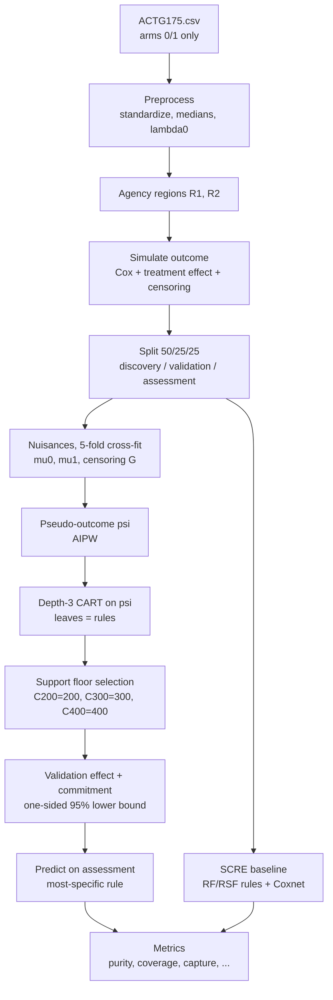

# CISCaRL — End-to-End Pipeline (C200 / C300 / C400)

This document explains, in detail, how a CISCaRL run works: from the raw
ACTG175 file to the final comparison metrics.

**Estimand.** For a patient with covariates `x`, at horizon `t* = 730` days:

```
tau(x) = S1(730 | x) - S0(730 | x)
```

a **survival-probability difference** (not a hazard ratio).

---

## Flowchart



---

## Stage 1 — Data

- Source: `data/ACTG175.csv` (ACTG175 HIV trial, arms 0 vs 1 only).
- Covariates: `cd40, cd8, age, wtkg, karnof, hemo, homo, race, gender, drugs,
  str2, symptom`.
- Loaded by `ciscarl2/dgp.py:load_covariate_pool`; the covariate pool is
  resampled to `n = 8000` rows for each replication (bootstrap of real patients).

## Stage 2 — Preprocessing

`ciscarl2/gate23.py:_config23`

- Standardize each covariate: `x = (x - mu) / sd`.
- Median cut-points for `cd40, age, karnof, wtkg`.
- Calibrate the baseline hazard `lambda0` so control survival at `t*` is 73.5%
  (`dgp.lambda0_for_target_survival`).

## Stage 3 — Data-generating process (semi-synthetic outcome)

`ciscarl2/gate23.py:_regions` and `_sim_two` (clean), `gate24.py:_sim_joint`
(joint-stress).

- **Benefit regions** (in standardized space):
  - `R1`: `cd40 < median` **and** `age > median`
  - `R2`: `karnof < median` **and** `wtkg < median`
  - `single` scenario = `R1`; `two` scenario = `R1 ∪ R2`.
- **Outcome model** (Cox):
  ```
  h(t | x, A) = lambda0 * exp( lp0(x) - A * max(e1, e2) )
  lp0(x) = x . BETA
  ```
  where `e1, e2` are the per-region effect sizes (`_delta_for`), so the treatment
  reduces the hazard only inside the beneficial region.
- **Censoring:** exponential with rate `lambda_c0 * exp(x . GAMMA)`; `lambda_c0` is
  calibrated to ~10% censoring at `t*`.
- **Truth:** the true survival functions are analytic:
  ```
  S0(x) = exp( -lambda0 * exp(lp0) * t* )
  S1(x) = exp( -lambda0 * exp(lp1) * t* )
  tau(x) = S1 - S0
  ```
- **Joint-stress** (`_sim_joint`) keeps `S(730)` fixed but adds a joint error
  (kappa = 3) and marginal censoring, to test robustness.

## Stage 4 — Splits

Disjoint **50% discovery / 25% validation / 25% assessment**, stratified by
treatment (`sweep1000.py:46-47`, `gate28.run_rep`). Assessment is never used for
selection, thresholds, or commitment.

## Stage 5 — Nuisance models + cross-fitting

`ciscarl2/estimators.py:crossfit_nuisances` (5 folds)

- **Outcome (per arm):** Cox PH model on the fitting folds; predict
  `mu_a(x) = s0_a ^ exp(x . beta_a)` at `t*`.
- **Censoring:** conditional Cox model on covariates:
  `G(t*|x) = s0_c ^ exp(x . beta_c)`.
- **Marginal censoring** (sensitivity row): Kaplan–Meier.
- Out-of-fold predictions ensure no patient's pseudo-outcome uses a model fitted
  on that patient.

## Stage 6 — IPCW weight cap

`ciscarl2/gate20.py:_capped_G` + `estimators.truncate_weights`

- Weights `1/G` are capped at the training-fold 95th/99th percentile, so a few
  near-censored patients cannot dominate the estimate.

## Stage 7 — Doubly-robust pseudo-outcome

`ciscarl2/gate2.py:pseudo_outcome`

```
Y  = 1{ Tobs > t* } / G
psi = (A - e) / (e*(1-e)) * (Y - mu_A) + (mu1 - mu0)
```

with `e = 0.5` because treatment is randomized. This is a cross-fitted AIPW /
DR-learner score: it is consistent if either the outcome model or the propensity
model is correct.

## Stage 8 — Rule discovery

`ciscarl2/gate11.py:_cart` + `rules.py:extract_leaf_rules`

- Fit `DecisionTreeRegressor(max_depth=3, min_samples_leaf=60)` on `psi` over the
  discovery set.
- Each root-to-leaf path becomes a rule of at most 3 conditions.
- `gate22._stats` gives each leaf's discovery mean `psi`, SE, and **support**.

## Stage 9 — Support-constrained selection

`sweep1000.py:71-89` (`FLOORS`)

- **C200:** among leaves with support >= 200, pick the highest discovery mean.
- **C300:** same, floor = 300 (our leading variant).
- **C400:** floor = 400 (ablation).
- If no leaf meets the floor, fall back to the global maximum.

## Stage 10 — Validation effect + commitment

`ciscarl2/gate19.py:_leaf_table`

- Estimate the selected leaf's effect on the **validation** set:
  `tau_hat = mean( phi1 - phi0 | rule )`, `SE = sqrt(sum((phi-mean)^2))/n`.
- **Commit** only if `tau_hat > 1.645 * SE` (one-sided 95% lower bound > 0).
- If not committed, the decision is **INSUFFICIENT** and nobody is treated.
  This is the abstention layer.

## Stage 11 — Prediction

`ciscarl2/gate19.py:_assign_effs`

- Assign each assessment patient to the **most-specific** matching rule (fewest
  patients / most conditions); unmatched patients get the default ATE.
- If the model abstained, the whole cohort is left untreated.

## Stage 12 — Metrics

`ciscarl2/gate28.py:_metrics`

| Metric | Definition |
|---|---|
| **purity** | fraction of treated patients truly in the beneficial region |
| **coverage** | fraction of assessment patients treated |
| **capture** | share of total true benefit captured |
| **per-treatment** | mean true effect among treated patients |
| **efficiency** | per-treatment / oracle (best-k) |
| **null** | per-treatment <= 0.01 |
| **MAE** | mean absolute error of estimated vs true CATE |
| **Spearman** | rank correlation of estimated vs true CATE |

## Stage 13 — SCRE baseline

`scre.py:SurvivalCausalRuleEnsemble` + `gate4.py:scre_select_alpha`

- Generate rules from a Random Forest (predictive) and a Random Survival Forest
  (prognostic).
- Build a shared-basis design: linear terms + rule indicators + treatment
  interactions + rule-by-treatment interactions.
- Fit a `CoxnetSurvivalAnalysis` (elastic net Cox); choose alpha by validation
  C-index.
- Predict `tau = S1 - S0`; SCRE has **no abstention** (always treats `tau > 0`).

## Stage 14 — Experiment harness

`sweep1000.py`, `sweep1000_stress.py`, `sweep100.py`

- Repeat Stages 3–13 over many independent seeds (100 or 1000).
- Checkpoint every N reps to `results/sweep1000_<kind>_partial.csv`; resume by
  skipping completed reps.
- Summaries: mean, SD, 95% CI, median, p10, % purity >= 0.80, coverage, capture,
  per-treatment, commitment, MAE.

## Stage 15 — Real-data path (illustration)

`ciscarl2/demo_c200.py`

- Uses the real ACTG175 `T, E, A` (no simulation).
- Runs the C200 pipeline; ACTG175 has no true CATE, so no MAE/purity.
- Result: `tau(730) = +0.144 [0.025, 0.262]`; the 200-patient floor is unmet
  (largest leaf 174), so the model abstains: **INSUFFICIENT**.

---

## Configs

| Config | Support floor | Role |
|---|---|---|
| C200 | 200 | paper / frozen model |
| C300 | 300 | our leading variant (more coverage at ~1-2 purity pts lower) |
| C400 | 400 | ablation |

## Honest limitations

- ACTG175 has no observed individual treatment effect; accuracy is measured only
  in simulation.
- Intervals are empirical (~93%), not nominally valid 95%.
- SCRE is bundled as a Python reimplementation, not the authors' R package.
- The strict "purity >= 0.80 per run" is not guaranteed; report it conditionally
  with the commitment rate.
